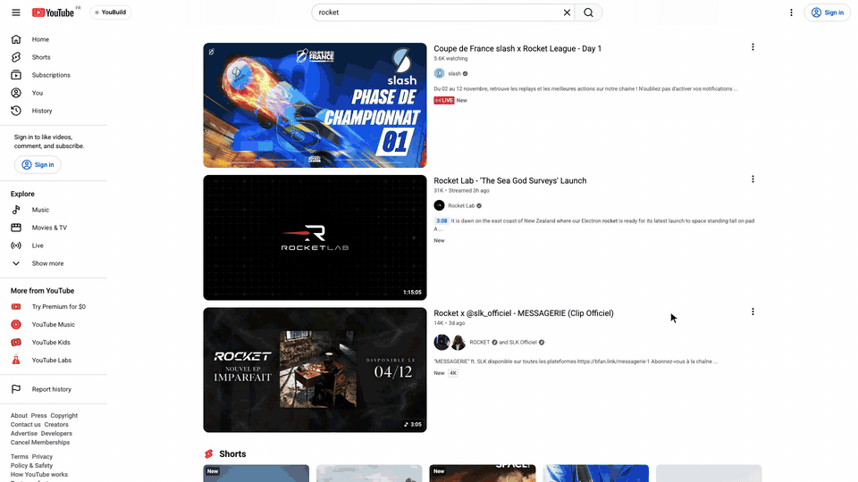
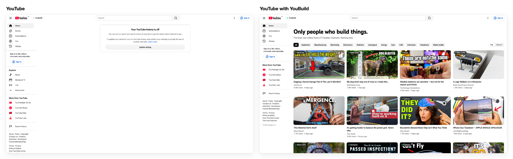
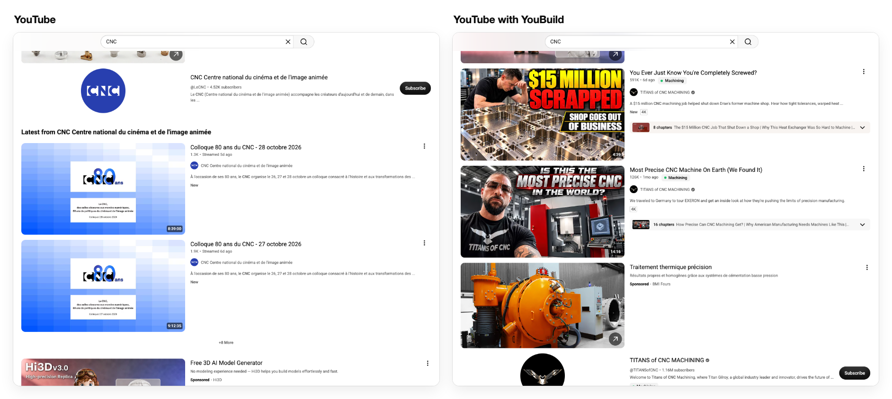
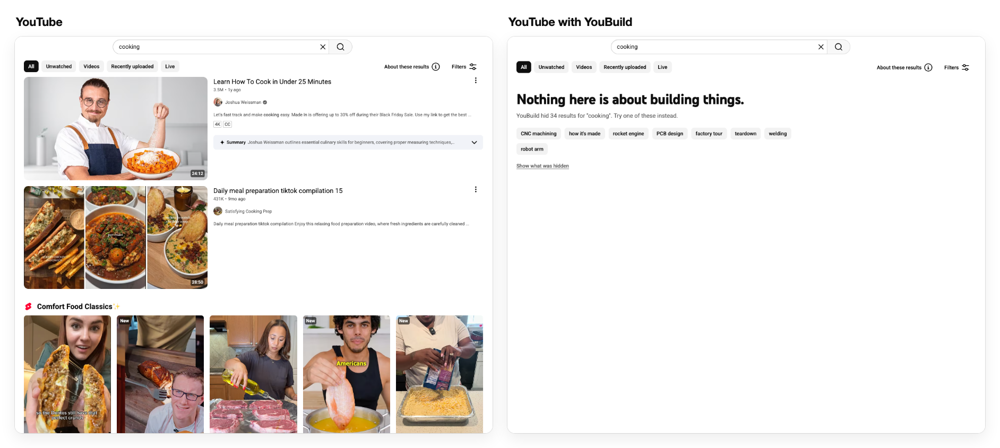
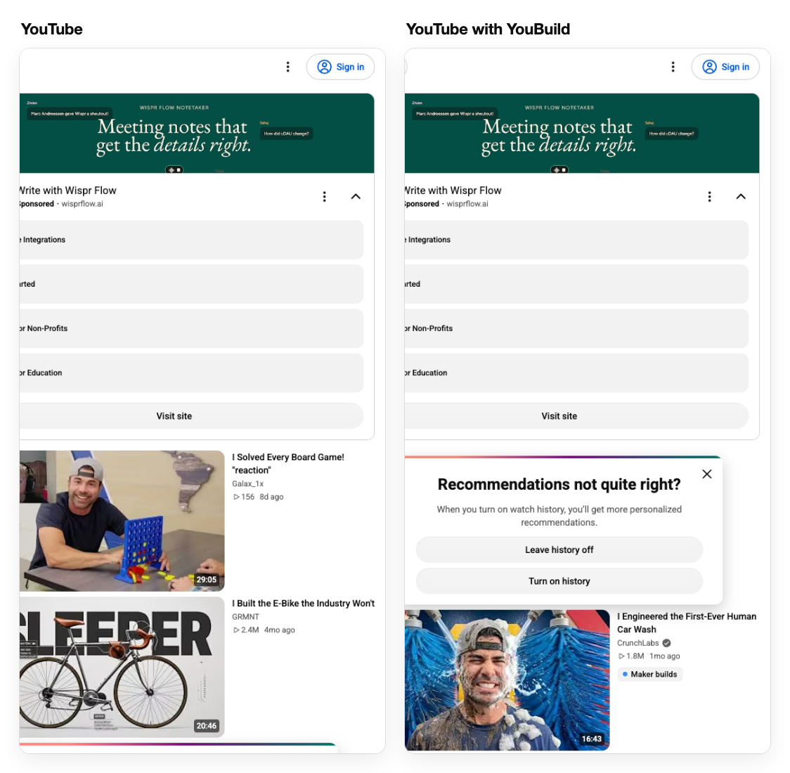

# YouBuild

YouTube, but only people who build things.

YouBuild is a browser extension that hides every YouTube video that is not about building things, and replaces the home page with the best new videos from 217 builder channels: engineering and physics, factories, machining and welding, electronics, robotics, rockets, energy, cars, CAD, teardowns, maker builds and interviews with the people who build.

It is not in the Chrome Web Store yet. Install it in three steps:

1. Download `youbuild-v0.1.0.zip` from [Releases](https://github.com/AirsupHQ/youbuild/releases/latest) and unzip it.
2. Open `chrome://extensions` and turn on Developer mode, top right.
3. Click Load unpacked and pick the `youbuild-v0.1.0` folder.

The same works in Edge, Brave and Arc. The release also has a Firefox build: open `about:debugging`, click This Firefox, then Load Temporary Add-on, and pick `youbuild-v0.1.0-firefox.zip`. It passes Mozilla's checks but has had less testing than the Chrome one.

YouBuild decides in three steps, cheapest first. A video from a channel on the [builder list](data/channels.json) is shown. Every one of the 217 channels was looked up on YouTube and its latest uploads read before it went on the list. A few channels on it mix in other topics, like Lex Fridman, TED or Y Combinator, and from those only the building videos are shown. Channels on the blocklist, content farms like 5-Minute Crafts, stay hidden.

Every other video goes through a topic check in your browser, on its title, channel and description: about 880 words and phrases about building things in a few languages, and about 310 that point the other way, like recipes, gameplay, music videos, pranks and celebrity news. On fresh searches it was not tuned on, it kept 92% of the results for building searches (most of the rest were tool reviews and buying guides) and let 1 of 183 results from other searches through.

When the topic check is not sure, YouBuild can ask Claude, with your own Anthropic API key. It is off until you turn it on in the settings. Your key stays in your browser and goes only to api.anthropic.com, with the title, channel and description of the unclear videos. Answers are cached per video, and Claude Haiku 5.5 costs about 3 cents per 1,000 videos.

Every video that stays has a small chip that says why. Hover it: the channel is on the list, these words matched, or this is what Claude said. The YouBuild pill next to the YouTube logo pauses YouBuild or shows what it hid. In the settings you pick builder list only or list plus topic check, the categories you want, whether to hide Shorts and comments, a minimum length, your own channels and blocks, and you can import and export your list.

YouBuild only changes what your own browser shows. It downloads and re-hosts nothing, it leaves ads alone, it has no server and it tracks nothing. It talks to YouTube (the pages you open and the public channel feeds for the home page) and, only if you turn it on, to the Claude API.

To add a channel for yourself, paste its link or @handle in the settings, or open any of its videos and click Add the channel in this tab. To add it for everyone, open a pull request that adds it to [data/channels.json](data/channels.json) with its id, handle, name and one or more of the categories in [src/lib/filter.js](src/lib/filter.js). `npm run verify` checks every channel on the list against YouTube and `npm test` checks the file. Pull requests to the channel list are welcome, especially great builders who are missing, and so are new words for the topic check with a real title that shows why.

To record a demo in a clean browser, run `npm install`, then `npm run demo`. It opens Playwright's own Chromium, not your Chrome, with a new empty profile, YouBuild loaded and youtube.com at 1920 x 1080. Close the window when you are done and the profile is deleted.

MIT license. Made by [Airsup](https://airsup.ai).
